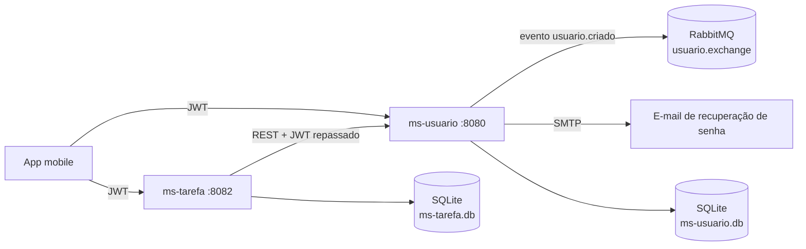
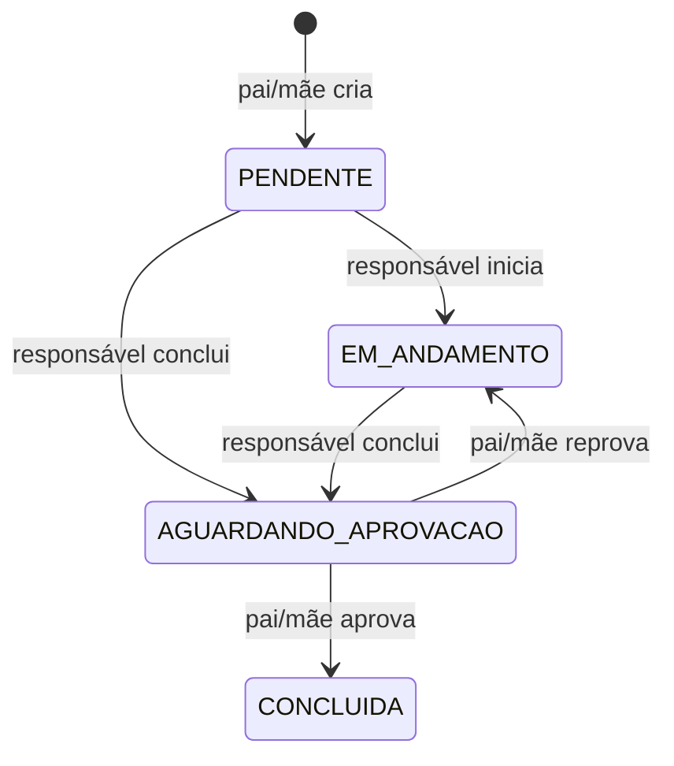

# House Task Manager


Gerenciador de tarefas domésticas para a família, construído em **microsserviços** com Spring Boot. Pai e mãe criam e aprovam tarefas, e os filhos iniciam e entregam. Uma tarefa só é concluída depois que um responsável aprova a entrega.

Front-end mobile: [frontend-mobile-house-task-manager-java](https://github.com/Bifaniii/frontend-mobile-house-task-manager-java)

## Arquitetura



- **ms-usuario**: cadastro, login com JWT, perfis por parentesco (MAE, PAI, FILHO) e recuperação de senha por e-mail com token de uso único que vale 30 minutos. Publica o evento `usuario.criado` no RabbitMQ a cada cadastro.
- **ms-tarefa**: CRUD e fluxo de status das tarefas. Valida o JWT emitido pelo ms-usuario (segredo compartilhado) e consulta o ms-usuario via `RestClient` para saber o parentesco de quem está chamando.
- Cada serviço tem seu próprio banco SQLite (arquivo criado automaticamente, sem servidor de banco). Falha do RabbitMQ ou do SMTP não derruba o cadastro nem a recuperação de senha: o erro é registrado em log e a requisição segue.

## Fluxo de uma tarefa



Transição inválida responde **409**, ação sem permissão responde **403** e token ausente ou inválido responde **401**.

## Tecnologias

- Java 17, Spring Boot 4 (Web MVC, Data JPA, Validation, Security, AMQP, Mail, RestClient)
- JWT (jjwt) com segredo compartilhado entre os serviços
- SQLite, RabbitMQ 3
- Docker e Docker Compose com healthchecks
- JUnit 5, Mockito, MockMvc e MockRestServiceServer, com H2 nos testes
- GitHub Actions rodando os testes dos dois serviços

## Endpoints

**ms-usuario** (`:8080`)

| Método | Rota | Acesso |
| :----- | :--- | :----- |
| POST | `/usuarios/registrar` | Público |
| POST | `/usuarios/login` | Público |
| POST | `/usuarios/esqueci-senha` | Público |
| POST | `/usuarios/redefinir-senha` | Público |
| GET | `/usuarios`, `/usuarios/{id}`, `/usuarios/parentesco/{parentesco}` | Autenticado |
| DELETE | `/usuarios/{id}` | Pai ou mãe |

**ms-tarefa** (`:8082`)

| Método | Rota | Acesso |
| :----- | :--- | :----- |
| POST | `/tarefas` | Pai ou mãe |
| GET | `/tarefas`, `/tarefas/{id}`, `/tarefas/usuario/{usuarioId}` | Autenticado |
| PATCH | `/tarefas/{id}/iniciar`, `/tarefas/{id}/concluir` | Responsável pela tarefa |
| PATCH | `/tarefas/{id}/aprovar`, `/tarefas/{id}/reprovar` | Pai ou mãe |
| DELETE | `/tarefas/{id}` | Pai ou mãe |

## Como rodar

```bash
cp env-example .env   # preencha RabbitMQ, JWT_SECRET e SMTP
docker compose up --build
```

O `JWT_SECRET` precisa ter pelo menos 32 caracteres e ser o mesmo para os dois serviços. O painel do RabbitMQ fica em `http://localhost:15672`.

Sem Docker, cada serviço também roda direto (`./mvnw spring-boot:run` com `JWT_SECRET` definido) e cria o arquivo `.db` na própria pasta.

## Deploy no Render

1. No Render: **New > Blueprint** e selecione este repositório. O `render.yaml` cria o `ms-usuario` e o `ms-tarefa` e gera um `JWT_SECRET` compartilhado.
2. Quando o `ms-usuario` subir, copie a URL pública dele (ex.: `https://ms-usuario-xxxx.onrender.com`) e coloque em `MS_USUARIOS_URL` no `ms-tarefa`.
3. Opcional: preencha `SPRING_MAIL_*` no `ms-usuario` para a recuperação de senha.

O Render define a porta pela variável `PORT`, que os serviços já leem. Não há RabbitMQ no Render: o cadastro funciona normalmente e só registra um aviso no log.

> **Atenção:** no plano free o disco do Render é temporário. O arquivo SQLite é apagado a cada deploy e quando o serviço hiberna (após ~15 min sem acesso). Para manter os dados, use um plano pago com **Persistent Disk** (ex.: montado em `/app/data`) e defina `DB_PATH=/app/data/ms-usuario.db` / `DB_PATH=/app/data/ms-tarefa.db`.

## Testes

```bash
cd ms-usuario && ./mvnw test
cd ms-tarefa && ./mvnw test
```

- **ms-usuario**: cadastro com evento no RabbitMQ (inclusive com o broker fora do ar), login, recuperação de senha (token expirado, token já usado, e-mail inexistente sem revelar se a conta existe), JWT, publisher e e-mail.
- **ms-tarefa**: todas as transições de status e permissões (403/409/404), compatibilidade com o JWT emitido pelo ms-usuario e o client HTTP entre serviços com `MockRestServiceServer`.
- Controllers dos dois serviços com MockMvc (status HTTP e validação).
