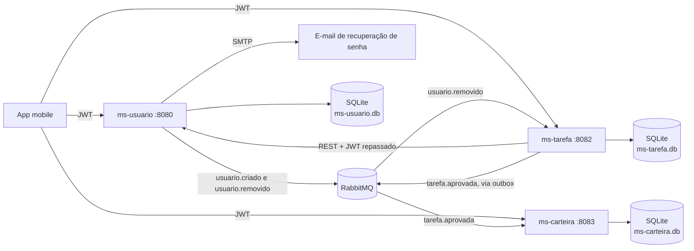
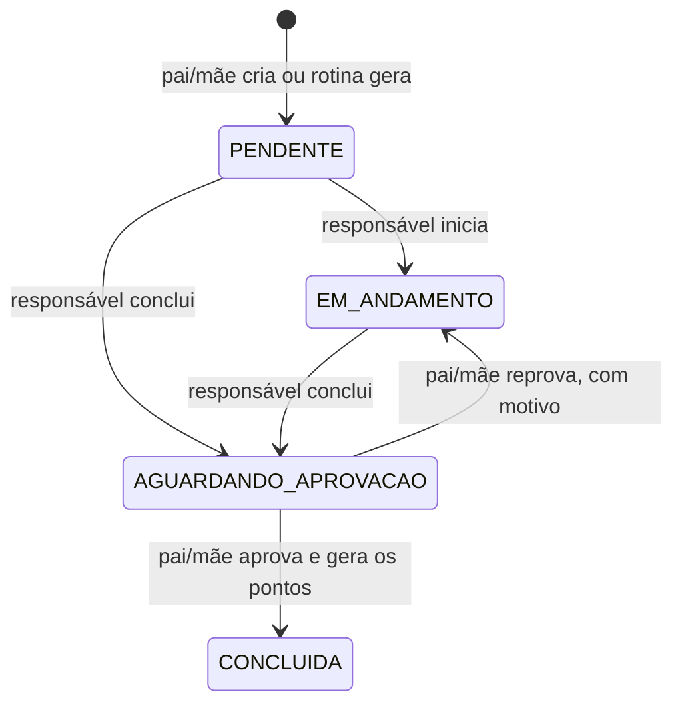

# House Task Manager


Gerenciador de tarefas domésticas para a família, construído em **microsserviços** com Spring Boot. Cada família tem seu espaço, entra por convite e organiza tarefas com prazo, rotinas com rodízio justo, prova por foto e uma carteira de pontos que vira prêmios.

Front-end mobile: [frontend-mobile-house-task-manager-java](https://github.com/Bifaniii/frontend-mobile-house-task-manager-java)

## Arquitetura



- **ms-usuario**: famílias com código de convite, cadastro, login com JWT, perfis por parentesco (MAE, PAI, FILHO) e recuperação de senha. O token carrega `usuarioId`, `familiaId` e `parentesco`.
- **ms-tarefa**: tarefas e seu fluxo, rotinas com rodízio justo, fotos, notificações e publicação dos eventos de aprovação.
- **ms-carteira**: saldo, extrato imutável, prêmios e resgates. Só recebe pontos por evento.
- Cada serviço tem seu próprio banco SQLite. Toda consulta é limitada à família do token: dados de outra família respondem 404, sem revelar que existem.

## Regras principais

**Famílias.** Mãe ou pai se cadastra criando uma família ou entrando com um código de convite, que pode ser trocado a qualquer momento. Conta de filho só é criada por mãe ou pai, em `POST /usuarios/filhos`; o cadastro público recusa `FILHO` com 403. A família não pode ficar sem responsável enquanto tiver filhos.

**Tarefas.** Uma tarefa pode ter prazo, valor em pontos e exigir foto do depois para a entrega.



Transição inválida responde **409**, ação sem permissão responde **403** e token ausente ou inválido responde **401**.

**Rodízio justo.** Uma rotina gera tarefas por dia ou por semana. Com mais de um participante, a próxima vai para quem acumulou menos pontos em tarefas nas últimas duas semanas, de modo que tarefa difícil pesa mais. No empate, evita repetir a pessoa da vez anterior e depois prefere quem recebeu tarefa há mais tempo. Se o serviço ficou parado, nasce uma tarefa só, sem acumular as perdidas.

**Carteira.** Os pontos só existem como lançamentos no extrato, que nunca é editado. O resgate debita na hora e, se for recusado, gera um estorno. O saldo nunca fica negativo.

## Confiabilidade dos pontos

Aprovar uma tarefa grava o evento na tabela de outbox, na mesma transação. Um agendador envia ao RabbitMQ com confirmação do broker e só então marca como publicado. Se o broker estiver fora, a aprovação funciona normalmente e o evento sai quando ele voltar. O consumidor usa o id do evento como chave única do extrato, então uma entrega repetida não credita duas vezes.

## Endpoints

**ms-usuario** (`:8080`)

| Método | Rota | Acesso |
| :----- | :--- | :----- |
| POST | `/usuarios/registrar` | Público, só mãe ou pai |
| POST | `/usuarios/login`, `/usuarios/esqueci-senha`, `/usuarios/redefinir-senha` | Público |
| POST | `/usuarios/filhos` | Pai ou mãe |
| GET | `/usuarios`, `/usuarios/{id}`, `/usuarios/parentesco/{parentesco}` | Família |
| DELETE | `/usuarios/{id}` | Pai ou mãe |
| GET | `/familias/minha` | Família; só pai ou mãe recebe o código |
| POST | `/familias/minha/codigo` | Pai ou mãe |

**ms-tarefa** (`:8082`)

| Método | Rota | Acesso |
| :----- | :--- | :----- |
| POST | `/tarefas` | Pai ou mãe |
| GET | `/tarefas`, `/tarefas/{id}`, `/tarefas/usuario/{usuarioId}` | Família |
| PATCH | `/tarefas/{id}/iniciar`, `/tarefas/{id}/concluir` | Responsável pela tarefa |
| PATCH | `/tarefas/{id}/aprovar`, `/tarefas/{id}/reprovar` | Pai ou mãe |
| DELETE | `/tarefas/{id}` | Pai ou mãe |
| POST | `/tarefas/{id}/fotos/{ANTES ou DEPOIS}` | Responsável; JPEG ou PNG de até 2 MB |
| GET | `/tarefas/{id}/fotos`, `/tarefas/{id}/fotos/{tipo}` | Família |
| GET | `/rotinas` | Família |
| POST | `/rotinas` | Pai ou mãe |
| PATCH, DELETE | `/rotinas/{id}/ativa`, `/rotinas/{id}` | Pai ou mãe |
| GET | `/notificacoes` | Quem está logado |
| PATCH | `/notificacoes/lidas` | Quem está logado |

**ms-carteira** (`:8083`)

| Método | Rota | Acesso |
| :----- | :--- | :----- |
| GET | `/carteiras/minha` | Quem está logado |
| GET | `/carteiras` | Família |
| GET | `/premios` | Família |
| POST, DELETE | `/premios`, `/premios/{id}` | Pai ou mãe |
| GET | `/resgates` | Pai ou mãe vê a família; filho vê os próprios |
| POST | `/resgates` | Família |
| PATCH | `/resgates/{id}/aprovar`, `/resgates/{id}/recusar` | Pai ou mãe |

## Tecnologias

- Java 17, Spring Boot 3 e 4 (Web MVC, Data JPA, Validation, Security, AMQP, Mail, RestClient, Scheduling)
- JWT (jjwt) com segredo compartilhado entre os serviços
- SQLite, RabbitMQ 3
- Docker e Docker Compose com healthchecks
- JUnit 5, Mockito, MockMvc e MockRestServiceServer, com H2 nos testes
- GitHub Actions rodando os testes dos três serviços

## Como rodar

```bash
cp env-example .env   # preencha RabbitMQ, JWT_SECRET e SMTP
docker compose up --build
```

O `JWT_SECRET` precisa ter pelo menos 32 caracteres e ser o mesmo para os três serviços. O painel do RabbitMQ fica em `http://localhost:15672`.

Sem Docker, cada serviço também roda direto (`./mvnw spring-boot:run` com `JWT_SECRET` definido) e cria o arquivo `.db` na própria pasta. Sem RabbitMQ, tudo funciona, menos o crédito de pontos, que fica guardado até o broker aparecer.

## CORS

O app no celular não passa por CORS. Só a versão web (`npx expo start --web`) precisa que o backend libere a origem dela. Os três serviços aceitam as origens listadas em `APP_CORS_ORIGENS`, separadas por vírgula, e o padrão é `http://localhost:8081`. Outras origens recebem 403 no pré-voo. Não use `*`: libere só os endereços que você usa.

```bash
APP_CORS_ORIGENS=http://localhost:8081,https://meu-app-web.exemplo.com
```

## Deploy no Render

1. Crie um RabbitMQ gerenciado, porque o Render não oferece um (o [CloudAMQP](https://www.cloudamqp.com/) tem plano gratuito), e copie a URL `amqps://`.
2. No Render: **New > Blueprint** e selecione este repositório. O `render.yaml` cria os três serviços e gera um `JWT_SECRET` compartilhado.
3. Coloque a URL do broker em `SPRING_RABBITMQ_ADDRESSES` nos três serviços.
4. Quando o `ms-usuario` subir, copie a URL pública dele e coloque em `MS_USUARIOS_URL` no `ms-tarefa`.
5. Opcional: preencha `SPRING_MAIL_*` no `ms-usuario` para a recuperação de senha.
6. Opcional: para usar a versão web do app, defina `APP_CORS_ORIGENS` nos três serviços (veja abaixo).

Quem já usa o Blueprint precisa sincronizá-lo para criar o `ms-carteira`.

> **Atenção:** no plano free o disco do Render é temporário. Os arquivos SQLite são apagados a cada deploy e quando o serviço hiberna, o que inclui famílias, tarefas, fotos e pontos. Para manter os dados, use um plano pago com **Persistent Disk** (ex.: montado em `/app/data`) e defina `DB_PATH` em cada serviço.

Enquanto hiberna, o serviço não executa agendadores. Por isso as rotinas também são geradas quando a lista de tarefas é pedida. Avisos de prazo só saem com o serviço acordado.

## Migração

Na primeira subida depois das famílias, as contas e tarefas antigas vão para uma única família, com convite aleatório. Isso mantém o que elas já enxergavam. Tokens antigos não têm `familiaId`: respondem 401 e a pessoa entra de novo.

## Testes

```bash
cd ms-usuario && ./mvnw test
cd ms-tarefa && ./mvnw test
cd ms-carteira && ./mvnw test
```

- **ms-usuario**: famílias e convites, cadastro protegido, isolamento, último responsável, eventos com o broker fora do ar, login, recuperação de senha, JWT e e-mail.
- **ms-tarefa**: transições e permissões, isolamento, foto obrigatória, validação de imagem pelos bytes, geração de rotinas, equilíbrio do rodízio, outbox e compatibilidade com o JWT do ms-usuario.
- **ms-carteira**, com banco real: crédito idempotente, mensagem malformada, saldo insuficiente, estorno único e isolamento entre famílias.

Para rodar os testes com JDK 24 ou mais novo, o `ms-usuario` precisa de um Lombok mais recente que o da versão do Spring Boot dele. O projeto usa Java 17, como o CI e os Dockerfiles.
